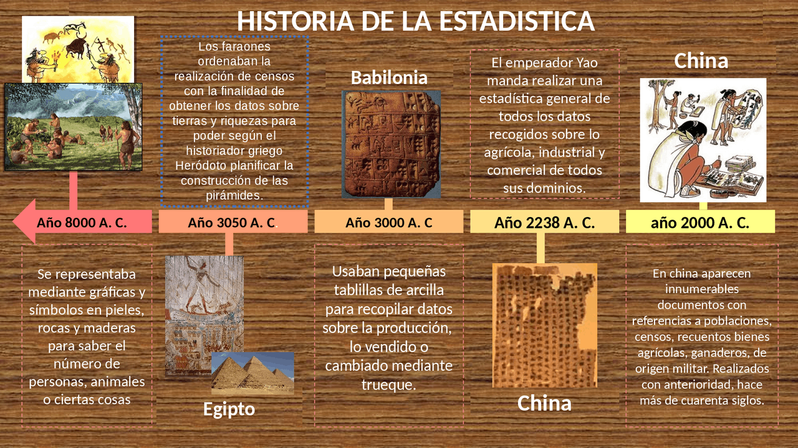
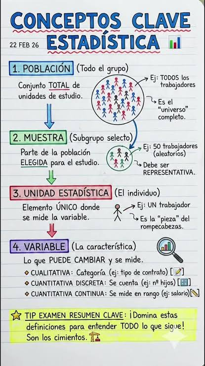
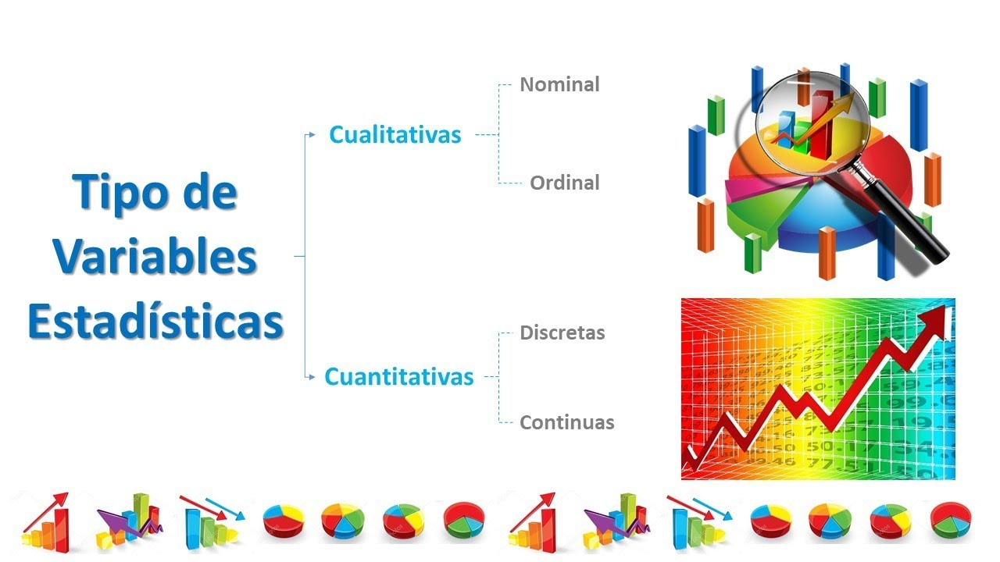
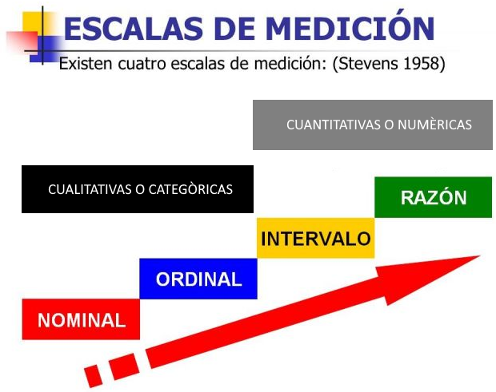

```{=html}
<div style="position:absolute; top:10px; right:10px;">

</div>
```

```{=html}
<style>
body{
  background-color:#fcfcfa;
  font-size:130%;
  text-align:justify;
}
</style>
```

# .Presentación

La estadística proporciona herramientas para transformar datos en información útil. Se utiliza en la educación, la administración pública, la economía, la salud, el deporte, las ciencias naturales y las ciencias sociales. Este documento presenta una introducción conceptual e histórica y desarrolla la clasificación de las variables según su naturaleza y su **escala** de medición, con ejemplos y actividades reproducibles en **R**.

::: callout-note
**Propósito de aprendizaje.** Al finalizar, el estudiante podrá explicar hitos de la historia de la estadística, diferenciar sus conceptos fundamentales, identificar variables en una situación de investigación y clasificarlas según su naturaleza y nivel de medición.
:::

# .Historia de la estadística

{fig-align="center"}

**Orígenes: contar para organizar la sociedad**

La estadística no surgió de manera repentina. Se desarrolló a lo largo de un proceso histórico que comenzó con la necesidad de contar personas, animales, cosechas, bienes y recursos. En sociedades antiguas, estos registros ayudaban a organizar el trabajo, distribuir recursos, recaudar tributos y planificar actividades colectivas.

Antes de existir sistemas de escritura complejos, se empleaban marcas, símbolos y representaciones en rocas, madera, pieles y paredes. El documento histórico suministrado destaca que estos procedimientos permitían llevar cuentas de personas, animales y objetos.

**Civilizaciones antiguas**

| Civilización o sociedad | Aporte descrito en el material histórico | Finalidad principal |
|------------------------|------------------------|------------------------|
| Babilonia | Uso de tablillas de arcilla para registrar datos de producción agrícola y bienes intercambiados. | Control económico y comercial. |
| Egipto | Registros de población, rentas y censos. | Administración del territorio y de los recursos. |
| China | Realización de censos y recopilación de información agrícola, industrial y comercial. | Organización del Estado. |
| Grecia | Registros relacionados con tierras, tributos, servicio militar y ciudadanía. | Administración social, fiscal y militar. |
| Roma | Recuentos periódicos de población, nacimientos, defunciones, matrimonios, ganado y riquezas. | Organización política y fiscal. |
| Incas | Uso de quipus —cuerdas y nudos— para registrar sucesos y datos de la población. | Administración de provincias y recursos. |

Estos antecedentes muestran que la recolección de datos estuvo estrechamente ligada a las necesidades de gobierno. En la historia se describen ejemplos de Babilonia, Egipto, Grecia y Roma.

**Edad Media y registros demográficos**

Durante la Edad Media, los registros estadísticos fueron menos sistemáticos en algunos territorios europeos, aunque continuaron inventarios de tierras y bienes. Más adelante, las instituciones religiosas y civiles fortalecieron los registros de nacimientos, matrimonios y defunciones.

Estos registros fueron importantes porque permitieron estudiar la evolución de la población y sentaron bases para los análisis demográficos.

**Siglos XVII y XVIII: de contar a analizar**

En estos siglos se consolidaron formas más sistemáticas de analizar datos. El material histórico destaca:

- **John Graunt:** analizó registros de mortalidad de Londres y realizó estimaciones sobre nacimientos y defunciones.
- **Edmond Halley:** aplicó información demográfica al estudio de la duración de la vida y las tablas de mortalidad, útiles posteriormente en seguros.
- **Gaspar Neumann:** examinó registros de defunciones para contrastar una creencia popular con evidencia empírica.
- **Desarrollo de la probabilidad:** matemáticos como Jakob Bernoulli y Pierre-Simon Laplace contribuyeron al desarrollo de herramientas probabilísticas que ampliarían las posibilidades de la inferencia estadística.

La idea central de esta etapa es que los datos comenzaron a emplearse no solo para describir lo ocurrido, sino también para examinar regularidades, evaluar afirmaciones y formular estimaciones.

**Siglos XVIII y XIX: formalización matemática**

El desarrollo de las ciencias y del método científico favoreció la incorporación de técnicas cuantitativas a la investigación. Entre 1800 y 1820, se destacaron la teoría de los errores de observación y el método de mínimos cuadrados, asociados con Laplace, Gauss y Legendre.

También se amplió el uso de la estadística en el estudio de fenómenos sociales y demográficos. La estadística empezó a consolidarse como una disciplina que combina observación, organización de datos, razonamiento matemático e interpretación.

**Siglos XX y XXI: computación y análisis de datos**

La informática transformó profundamente el trabajo estadístico. Los computadores permiten almacenar grandes bases de datos, realizar cálculos complejos, simular fenómenos, construir visualizaciones y ajustar modelos en tiempos reducidos.

Actualmente, la estadística se utiliza para describir fenómenos y apoyar decisiones basadas en evidencia. Herramientas como **R**, RStudio y Quarto permiten documentar de manera reproducible los datos, el código, los resultados y las interpretaciones.

**Síntesis de la evolución histórica**

La historia puede resumirse en tres grandes etapas didácticas:

1.  **Registros y censos:** contar personas, bienes, animales y recursos.
2.  **Descripción y aritmética política:** organizar recuentos y estudiar características de la población y del Estado.
3.  **Estadística, probabilidad y computación:** analizar incertidumbre, hacer inferencias, modelar fenómenos y trabajar con grandes volúmenes de información.

::: callout-important
La estadística moderna no consiste únicamente en calcular números o elaborar gráficos. Su valor está en formular preguntas pertinentes, obtener datos de calidad, elegir métodos adecuados e interpretar los resultados dentro de su contexto.
:::

# .Conceptos

{fig-align="center"}

**¿Qué es la estadística?**

La estadística es la disciplina que recoge, organiza, presenta, analiza e interpreta datos con el propósito de describir fenómenos, obtener conclusiones y apoyar la toma de decisiones.

Se divide habitualmente en dos grandes ramas.

**Estadística descriptiva**

Comprende métodos para organizar, resumir y presentar los datos observados. Utiliza tablas de frecuencias, gráficos, medidas de tendencia central, medidas de dispersión y otros resúmenes numéricos.

*Ejemplo:* una universidad presenta el porcentaje de estudiantes matriculados en cada programa académico durante el semestre.

**Estadística inferencial**

Utiliza información de una muestra para estimar características de una población, contrastar hipótesis o construir predicciones, considerando la incertidumbre del proceso de muestreo.

*Ejemplo:* se encuesta a una muestra de estudiantes para estimar la proporción de toda la universidad que está satisfecha con los servicios de bienestar.

| Aspecto | Descriptiva | Inferencial |
|------------------------|------------------------|------------------------|
| Pregunta principal | ¿Qué muestran los datos observados? | ¿Qué podemos concluir sobre la población a partir de una muestra? |
| Herramientas comunes | Tablas, gráficos, medias, medianas, desviaciones estándar. | Estimación, intervalos de confianza, pruebas de hipótesis, modelos. |
| Alcance | Resume el conjunto de datos analizado. | Generaliza bajo supuestos y cuantifica incertidumbre. |

**Población**

La **población estadística** es el conjunto completo de individuos, unidades, objetos o mediciones que cumplen las condiciones de interés de una investigación.

**Ejemplos:**

- Todos los estudiantes matriculados en una universidad durante un semestre definido.
- Todos los hogares de un municipio en una fecha de referencia.
- Todas las solicitudes recibidas por una entidad pública durante un año.

La población debe delimitarse con claridad en cuanto a unidad de análisis, lugar y periodo.

**Muestra**

Una **muestra** es una parte de la población seleccionada para obtener información sobre ella. Para que las conclusiones sean confiables, el procedimiento de selección debe ser apropiado para el objetivo del estudio.

Las muestras pueden reducir costos, tiempo y esfuerzo. También resultan necesarias cuando medir a todas las unidades es inviable, costoso o destructivo.

**Ejemplo:** de los 8.000 estudiantes de una universidad, se seleccionan 400 mediante un procedimiento de muestreo para estudiar sus tiempos de desplazamiento.

::: callout-warning
Una muestra grande no garantiza por sí sola resultados representativos. La selección de participantes, la cobertura, la falta de respuesta y la calidad de las mediciones también afectan la validez de las conclusiones.
:::

**Unidad de análisis, dato y variable**

- **Unidad de análisis:** elemento sobre el que se recoge información; por ejemplo, un estudiante, un hogar, una institución o una solicitud.
- **Dato:** valor observado o registrado para una unidad; por ejemplo, 21 años, “Virtual” o 4 visitas.
- **Variable:** característica que puede tomar distintos valores entre las unidades de análisis; por ejemplo, edad, modalidad de estudio o número de visitas.

En una base de datos, las filas suelen representar unidades de análisis y las columnas variables.

**Parámetro y estadístico**

Un **parámetro** es una medida numérica que describe una característica de la población, como la media poblacional $\mu$ o la proporción poblacional $p$.

Un **estadístico** se calcula a partir de una muestra, como la media muestral $\bar{x}$, la desviación estándar muestral $s$ o la proporción muestral $\hat{p}$.

La inferencia estadística emplea estadísticos muestrales para estimar parámetros poblacionales.

**Datos y fuentes de información**

Los datos pueden proceder, entre otras fuentes, de:

- Encuestas y cuestionarios.
- Entrevistas.
- Observación directa.
- Registros administrativos.
- Reportes de producción o control de calidad.
- Bases de datos institucionales y sistemas de información.

Antes de analizar los datos es importante verificar su procedencia, periodo de referencia, definiciones, unidades de medida, valores faltantes y posibles errores de registro.

# .Variables estadísticas

{fig-align="center"}

**Concepto de variable**

Una **variable estadística** es una característica observada o medida en cada unidad de análisis que puede presentar diferentes valores o categorías.

Por ejemplo, en un estudio sobre estudiantes pueden registrarse la edad, la estatura, el programa académico, la modalidad de estudio, el número de asignaturas aprobadas y el nivel de satisfacción.

La forma de clasificar una variable depende de lo que representa y de cómo se obtiene el dato. **No basta con que un valor esté escrito con números para que la variable sea cuantitativa.** Un código numérico asignado a un programa académico sigue siendo una categoría.

**Clasificación según su naturaleza**

Las variables se clasifican inicialmente en **cualitativas** y **cuantitativas**.

**Variables cualitativas o categóricas**

Describen cualidades, atributos o categorías. Sus valores no expresan una cantidad numérica medida, aunque se codifiquen con números.

**Ejemplos:** estado civil, programa académico, tipo de contrato, modalidad de estudio y nivel de satisfacción.

Se distinguen dos tipos principales:

- **Nominales:** las categorías no tienen un orden natural. Ejemplos: municipio de residencia, tipo de contrato, programa académico.
- **Ordinales:** las categorías tienen un orden, pero las diferencias entre categorías no se pueden interpretar como distancias numéricas iguales. Ejemplos: satisfacción baja, media y alta; nivel educativo; nivel de riesgo bajo, moderado y alto.

**Variables cuantitativas**

Representan cantidades que pueden contarse o medirse. Se expresan numéricamente y permiten operaciones aritméticas pertinentes según la escala de medición.

**Ejemplos:** edad en años, número de hijos, ingreso mensual, estatura, tiempo de espera y número de trámites atendidos.

Se clasifican en:

- **Discretas:** resultan generalmente de contar y toman valores separados, habitualmente enteros. Ejemplos: número de estudiantes, número de llamadas recibidas y cantidad de solicitudes aprobadas.
- **Continuas:** resultan de medir y, conceptualmente, pueden tomar cualquier valor dentro de un intervalo, dependiendo de la precisión del instrumento. Ejemplos: estatura, peso, temperatura y tiempo de atención.

::: callout-tip
**Regla práctica:** si la pregunta es “¿cuántos?”, normalmente se obtiene un conteo discreto; si es “¿cuánto mide, pesa, dura o cuesta?”, puede tratarse de una medición cuantitativa. El contexto y la forma de registro son decisivos.
:::

**Cuadro comparativo de la naturaleza de las variables**

| Criterio | Tipo | Característica | Ejemplos |
|------------------|------------------|------------------|------------------|
| Naturaleza | Cualitativa nominal | Categorías sin orden inherente | Municipio, programa, tipo de contrato |
| Naturaleza | Cualitativa ordinal | Categorías con orden | Satisfacción, nivel educativo, riesgo |
| Naturaleza | Cuantitativa discreta | Conteos de valores separados | Número de hijos, solicitudes, llamadas |
| Naturaleza | Cuantitativa continua | Mediciones en una escala numérica continua | Peso, estatura, duración, temperatura |

# .Escalas o niveles de medición

{fig-align="center"}

La escala de medición indica qué significado tienen los valores y qué comparaciones u operaciones resultan válidas. En la clasificación tradicional se distinguen cuatro niveles: nominal, ordinal, intervalo y razón.

**Escala nominal**

Agrupa observaciones en categorías sin orden inherente. Permite identificar si dos observaciones pertenecen o no a la misma categoría y calcular frecuencias y proporciones.

**Ejemplos:** estado civil, tipo de institución, municipio, modalidad (presencial/virtual) y grupo sanguíneo.

Si se codifica modalidad como 1 = presencial y 2 = virtual, los números son etiquetas: no tiene sentido afirmar que 2 es “mayor” que 1.

**Análisis habituales:** frecuencias absolutas y relativas, porcentajes, moda y tablas de contingencia.

**Escala ordinal**

Clasifica las observaciones en categorías ordenadas. Se puede establecer cuál categoría está por encima o por debajo de otra, pero no se presupone que la distancia entre categorías sea constante.

**Ejemplos:** satisfacción (baja, media, alta), nivel de riesgo (bajo, moderado, alto) y nivel educativo.

**Análisis habituales:** frecuencias, porcentajes, moda, mediana y medidas basadas en rangos; la elección concreta depende del diseño y de los supuestos del análisis.

**Escala de intervalo**

Los valores están ordenados y las diferencias entre ellos son interpretables, pero el cero es convencional y no representa ausencia absoluta de la característica.

**Ejemplo clásico:** temperatura en grados Celsius o Fahrenheit. Una temperatura de veinte grados celcius no significa el doble de calor que diez grados celcius, aunque la diferencia entre ambas sea de diez grados celcius.

En esta escala tienen sentido las diferencias; las razones entre valores no suelen tener interpretación directa.

**Escala de razón**

Tiene orden, intervalos comparables y un cero que representa ausencia de la cantidad medida. Permite comparar diferencias y razones, siempre que la variable y sus unidades lo permitan.

**Ejemplos:** peso, estatura, duración, distancia, edad medida desde el nacimiento, ingresos y número de trámites.

Por ejemplo, una duración de 20 minutos es el doble de una duración de 10 minutos. Esta interpretación se sostiene porque el cero de duración representa ausencia de tiempo transcurrido.

**Resumen de las cuatro escalas**

| Escala | Clasifica | Ordena | Diferencias comparables | Cero absoluto | Ejemplos |
|------------|:----------:|:----------:|:----------:|:----------:|------------|
| Nominal | Sí | No | No | No aplica | Municipio, modalidad |
| Ordinal | Sí | Sí | No necesariamente | No aplica | Satisfacción, riesgo |
| Intervalo | Sí | Sí | Sí | No | Temperatura en °C |
| Razón | Sí | Sí | Sí | Sí | Peso, duración, conteos |

**Naturaleza y escala: no son lo mismo**

La naturaleza responde a la pregunta **“¿qué tipo de dato representa la variable?”**; la escala responde **“¿qué relaciones y operaciones tienen significado para esos valores?”**.

En la clasificación usual:

- Las variables cualitativas pueden ser nominales u ordinales.
- Las variables cuantitativas suelen medirse en escala de intervalo o de razón.
- La clasificación debe considerar el significado real de los valores, no solamente su apariencia o formato en una hoja de cálculo.

Algunas variables requieren criterio contextual. Por ejemplo, una calificación de 0 a 5 puede tratarse como ordinal si solo expresa categorías ordenadas de desempeño; en determinados análisis educativos se aproxima como cuantitativa, siempre justificando los supuestos. Un código postal es numérico en apariencia, pero nominal en su significado.

# .Aplicación práctica en R

{fig-align="center" width="800"}

R permite almacenar, clasificar, resumir y visualizar datos. En los ejemplos siguientes se usa una base ficticia de estudiantes; no corresponde a información real.

**Crear una base de datos de ejemplo**

```{r}
estudiantes <- data.frame(
  id = 1:12,
  programa = c("Matemáticas", "Derecho", "Administración",
               "Matemáticas", "Derecho", "Administración",
               "Matemáticas", "Derecho", "Administración",
               "Matemáticas", "Derecho", "Administración"),
  modalidad = c("Presencial", "Virtual", "Virtual", "Presencial",
                "Virtual", "Presencial", "Presencial", "Virtual",
                "Virtual", "Presencial", "Virtual", "Presencial"),
  satisfaccion = c("Alta", "Media", "Baja", "Alta", "Media", "Alta",
                   "Media", "Baja", "Alta", "Alta", "Media", "Media"),
  edad = c(18, 22, 25, 20, 23, 29, 21, 24, 27, 19, 26, 28),
  asignaturas_aprobadas = c(5, 4, 3, 6, 4, 5, 5, 2, 4, 6, 3, 5),
  tiempo_desplazamiento = c(15.5, 0, 32.0, 18.2, 0, 45.5,
                            12.0, 0, 28.4, 21.3, 0, 37.8)
)

head(estudiantes)
str(estudiantes)
```

En esta base:

- `programa` y `modalidad` son cualitativas nominales.
- `satisfaccion` es cualitativa ordinal.
- `edad` y `tiempo_desplazamiento` son cuantitativas; el tiempo se registra como medición continua.
- `asignaturas_aprobadas` es cuantitativa discreta.
- `id` es un identificador: aunque se escribe con números, no es una medida cuantitativa.

El tiempo de desplazamiento igual a cero se ha incluido para estudiantes que estudian virtualmente y no se desplazan al campus. En un estudio real convendría definir cuidadosamente qué significa ese cero y si corresponde registrar “no aplica” en lugar de cero.

**Declarar factores y su orden**

En R, `factor()` permite representar categorías. Para una variable ordinal, se especifican los niveles en el orden adecuado.

```{r}
estudiantes$programa <- factor(estudiantes$programa)

estudiantes$modalidad <- factor(
  estudiantes$modalidad,
  levels = c("Presencial", "Virtual")
)

estudiantes$satisfaccion <- factor(
  estudiantes$satisfaccion,
  levels = c("Baja", "Media", "Alta"),
  ordered = TRUE
)

str(estudiantes)
```

Declarar niveles no convierte por sí solo una variable en cuantitativa. Los factores permiten a R reconocer que los valores representan categorías.

**Tabla de frecuencias para una variable cualitativa**

```{r}
tabla_modalidad <- as.data.frame(
  table(estudiantes$modalidad)
)

names(tabla_modalidad) <- c("Modalidad", "Frecuencia")
tabla_modalidad$Porcentaje <- round(
  100 * tabla_modalidad$Frecuencia / sum(tabla_modalidad$Frecuencia), 1
)

tabla_modalidad
```

**Gráfico de barras con `ggplot2`**

```{r}
# Instale ggplot2 una sola vez, si aún no está instalado:
# install.packages("ggplot2")

library(ggplot2)

ggplot(estudiantes, aes(x = modalidad)) +
  geom_bar(fill = "#3977A8", color = "white") +
  labs(
    title = "Estudiantes por modalidad de estudio",
    x = "Modalidad",
    y = "Frecuencia"
  ) +
  theme_minimal(base_size = 12)
```

El gráfico de barras es apropiado para comparar frecuencias de categorías. En una variable nominal, el orden de las barras suele ser convencional; en una variable ordinal, conviene respetar el orden lógico de sus niveles.

**Resumen descriptivo de una variable cuantitativa**

```{r}
summary(estudiantes$edad)
mean(estudiantes$edad)
median(estudiantes$edad)
sd(estudiantes$edad)
```

La media y la desviación estándar resumen aspectos distintos de la distribución. La media describe el centro aritmético y la desviación estándar cuantifica la dispersión alrededor de la media; deben interpretarse teniendo en cuenta la escala de medición y la forma de la distribución.

**Histograma de una variable cuantitativa**

```{r}
ggplot(estudiantes, aes(x = edad)) +
  geom_histogram(binwidth = 2, color = "white", fill = "#2A9D8F") +
  labs(
    title = "Distribución de la edad de los estudiantes",
    x = "Edad (años)",
    y = "Frecuencia"
  ) +
  theme_minimal(base_size = 12)
```

Un histograma representa la distribución de una variable cuantitativa agrupando sus valores en intervalos. La elección del ancho de los intervalos afecta la apariencia del gráfico.

**Ejemplo integrador: estudio en una entidad pública**

Una alcaldía desea conocer las características de las solicitudes ciudadanas recibidas durante un trimestre. Para cada solicitud registra: tipo de trámite, prioridad, días hasta la respuesta, número de documentos anexos y satisfacción del usuario.

| Variable | Naturaleza | Clasificación específica | Escala habitual |
|------------------|------------------|------------------|------------------|
| Tipo de trámite | Cualitativa | Nominal | Nominal |
| Prioridad (baja, media, alta) | Cualitativa | Ordinal | Ordinal |
| Días hasta la respuesta | Cuantitativa | Continua si se mide tiempo transcurrido; discreta si se registra solo en días enteros | Razón |
| Número de documentos anexos | Cuantitativa | Discreta | Razón |
| Satisfacción (1 a 5, de muy baja a muy alta) | Cualitativa ordinal si los números representan categorías ordenadas | Ordinal | Ordinal |

Este ejemplo evidencia que la clasificación depende de cómo se define y mide cada variable. Si el tiempo se registra como número entero de días, la variable observada es discreta en la base, aunque el tiempo transcurrido subyacente sea continuo.

**Errores frecuentes al clasificar variables**

1.  **Confundir códigos con cantidades.** El código 1 para “Presencial” y 2 para “Virtual” no convierte la modalidad en cuantitativa.
2.  **Confundir ordinal con intervalo.** Que las categorías tengan un orden no significa que la distancia entre ellas sea igual.
3.  **Tratar todo conteo como continuo.** El número de trámites o personas atendidas es discreto.
4.  **Interpretar el cero sin revisar su significado.** En una escala de razón, el cero debe representar ausencia de la cantidad; en Celsius, el cero no significa ausencia de temperatura.
5.  **Elegir un análisis sin considerar el nivel de medición.** La técnica debe corresponder a la pregunta, el diseño y los supuestos, no solamente al tipo de columna en R.

# .Actividades de aprendizaje

{fig-align="center"}

**Actividad 1. Clasificación de variables**

Clasifique cada variable según su naturaleza, tipo específico y escala de medición. Justifique cada respuesta.

1.  Número de habitantes de un municipio.
2.  Nivel de satisfacción con un servicio público: bajo, medio o alto.
3.  Temperatura ambiente en grados Celsius.
4.  Ingreso mensual de un hogar en pesos.
5.  Tipo de institución educativa.
6.  Tiempo de espera en una oficina de atención.
7.  Número de solicitudes resueltas por funcionario.
8.  Estrato socioeconómico.
9.  Código de identificación de una persona.
10. Nivel educativo alcanzado.

**Actividad 2. Población y muestra**

Una universidad tiene 6.500 estudiantes matriculados y desea estimar el tiempo promedio que tardan en llegar al campus.

- Defina la población y la unidad de análisis.
- Proponga una muestra y describa un procedimiento de selección.
- Identifique la variable principal y su unidad de medida.
- Explique dos fuentes potenciales de sesgo.
- Indique qué resultados serían descriptivos y cuáles inferenciales.

**Actividad 3. Práctica con R**

Usando la base ficticia `estudiantes`:

1.  Construya una tabla de frecuencias para `programa`.
2.  Calcule los porcentajes de `satisfaccion`.
3.  Construya un gráfico de barras para `satisfaccion`, respetando el orden de sus categorías.
4.  Calcule media, mediana y desviación estándar de `edad`.
5.  Explique por qué `id` no debe analizarse como una variable cuantitativa.

**Conclusiones**

La estadística evolucionó desde los primeros registros y censos hasta convertirse en una disciplina que permite describir datos, cuantificar incertidumbre y apoyar decisiones. Para realizar un análisis correcto es indispensable delimitar la población, seleccionar adecuadamente la muestra, comprender las variables y reconocer sus escalas de medición.

La clasificación de las variables no es un trámite formal: orienta la construcción de tablas y gráficos, la selección de resúmenes numéricos y los métodos de análisis que resultan apropiados. En R, documentar explícitamente las categorías y el orden de los factores mejora la claridad y reproducibilidad del trabajo.

# .Referencias y materiales de apoyo

**Material suministrado para esta unidad**

- Salgado Horta, D. *Historia de la Estadística*. Material didáctico suministrado en PDF.
- Salgado Horta, D. *Estadística: Introducción – tipos de datos*. Período 2026-1. Material didáctico suministrado en PDF.
- Salgado Horta, D. *Estadística: Variables, niveles de medición*. Período 2026-1. Material didáctico suministrado en PDF.

**Documentación de R y Quarto**

- R Core Team. *R: A Language and Environment for Statistical Computing*. <https://www.r-project.org/>
- Posit. *Quarto*. <https://quarto.org/>
- Wickham, H., Çetinkaya-Rundel, M., & Grolemund, G. *R for Data Science*. <https://r4ds.hadley.nz/>

------------------------------------------------------------------------

*Documento didáctico elaborado para estudio y enseñanza de los fundamentos de la estadística. Los datos utilizados en los ejemplos de R son ficticios.*
